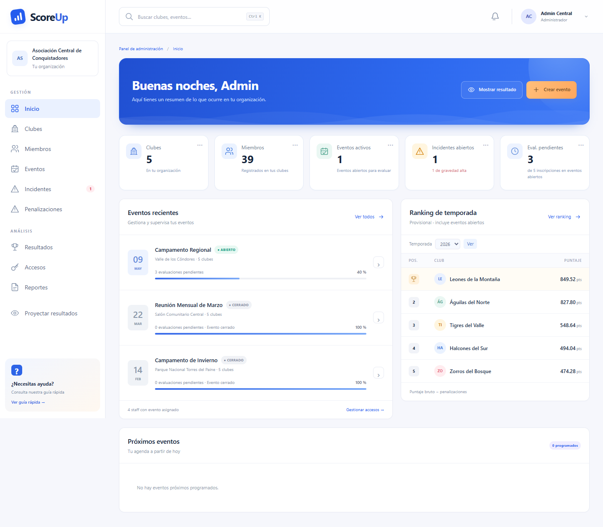

# ScoreUp — Sistema de Evaluación de Clubes de Conquistadores

<p align="center">
  
</p>

> Plataforma web para registrar, evaluar y calificar el desempeño de clubes de Conquistadores (y organizaciones similares) en eventos y temporadas.

Las capturas de esta página corresponden a la interfaz actual, generadas con una base aislada y datos ficticios de demostración; no muestran información de la instalación personal.

## Portada pública

La página `/` incluye diseño azul/naranja, ondas, vistas ilustrativas del producto, roles, guía de uso, preguntas frecuentes y una demostración del puntaje ponderado que no guarda datos. Tiene animaciones de entrada al hacer scroll, tarjetas flotantes, paralaje suave y barra de avance; respeta `prefers-reduced-motion` y conserva el contenido visible sin JavaScript. CSS, JavaScript e ilustraciones son locales, sin recursos externos. Los ejemplos están señalados como ilustrativos; no se publican datos de organizaciones.

Para verla si tienes una sesión iniciada, cierra sesión o abre una ventana privada: se conserva la redirección automática al panel del usuario. Prueba opcional en Edge: `.venv\Scripts\python.exe tests/manual_landing.py`.

**Login y registro** comparten la identidad azul/naranja de la portada: fondo con ondas, tarjeta blanca, animación suave y diseño adaptable. Recursos locales en `auth.css`/`auth.js`; botón para mostrar/ocultar contraseña y aviso de Bloq Mayús. Los errores conservan los campos no secretos, nunca la contraseña; se mantienen CSRF, acceso por roles y retorno al club después del login mediante QR. Prueba opcional con base temporal: `.venv\Scripts\python.exe tests/manual_auth.py`.

## Evaluación mediante QR (implementada)

Cada club tiene una tarjeta QR descargable e imprimible. El staff escanea con la cámara normal del celular e inicia sesión si hace falta; vuelve automáticamente al club. La primera evaluación guardada por **club y evento** es la oficial. Solo su autor puede corregirla mientras el evento esté abierto; cada corrección genera una notificación revisable en **Reportes**.

También puede entrar a **Staff → Escanear QR de un club**: **Activar cámara** abre directamente la captura de una foto, también en HTTP local. Confirmar la fotografía inicia la lectura. El navegador del teléfono decide si abre la cámara directamente o muestra su selector de captura. La tarjeta de importación muestra únicamente **Elegir imagen del QR** para PNG o galería, sin duplicar la captura. **Escaneo en vivo** queda como alternativa visible solo en HTTPS/localhost compatibles. **QReader** procesa fotos y fotogramas difíciles en el servidor de ScoreUp. La opción «Usar lectura avanzada QReader» está visible y activada inicialmente: envía la imagen reducida al servidor, sin guardarla en el historial. Desmarcarla conserva lectura exclusivamente local con jsQR.

Instalación de QReader en el entorno Python: `.venv\Scripts\python.exe -m pip install -r requirements-qr.txt`. Es recomendable instalar antes PyTorch/torchvision CPU desde su índice oficial, como hace el Dockerfile. QReader usa un modelo de detección que se descarga la primera vez; en Docker queda preparado durante la construcción. En Linux requiere libzbar0 y las bibliotecas de OpenCV, incluidas en el Dockerfile.

En Windows, si pyzbar informa que no puede cargar `libzbar-64.dll` o alguna dependencia, instalar el [runtime Visual C++ 2013 x64 de Microsoft](https://www.microsoft.com/en-us/download/details.aspx?id=40784). No descargar DLL de sitios desconocidos. Para preparar el modelo antes de trabajar sin internet: `.venv\Scripts\python.exe -c "from qr_reader import get_reader; get_reader()"`.

El lector de fotos prueba varias resoluciones/recortes y recupera contraste; usa además BarcodeDetector cuando el navegador lo ofrece. Los QR nuevos contienen un identificador firmado más corto, con mayor margen blanco y tarjeta ampliada; las tarjetas anteriores siguen siendo válidas. Descarga nuevamente para obtener la versión menos densa. Ningún lector puede recuperar una foto muy desenfocada, con reflejos sobre el código o partes fuera del encuadre.

En Windows, **`INICIAR.bat`** inicia la aplicación y muestra una dirección de red para los QR. PC y teléfono deben compartir red. En **Clubes → QR del club** se puede corregir esa dirección antes de descargar o imprimir; no cambia la identidad del club ni su evento. Si hay un servidor anterior, debe cerrarse primero.

**Guía para probar desde el celular:** [documents/GUIA_PRUEBAS_QR.md](documents/GUIA_PRUEBAS_QR.md).

Las evaluaciones oficiales antiguas se conservan, igual que los respaldos históricos (que no cuentan en el ranking). Al migrar una base anterior se genera automáticamente una copia `scoreup.db.backup-*`. No borres `.secret_key`: mantiene válidos los QR entre reinicios.

### Uso en campamento sin internet

La propuesta consiste en una laptop con ScoreUp y un router que conecte los teléfonos por Wi-Fi local, sin necesidad de salida a Internet. El diagrama interactivo y sus escenarios están en [documents/solucion-sin-internet/index.html](documents/solucion-sin-internet/index.html); descárgalo y ábrelo en el navegador, o usa `ABRIR.bat` de esa carpeta. Es una explicación, no configura equipos ni demuestra un despliegue real: faltan pruebas físicas, preparar el lector QR offline y retirar las dependencias externas restantes.

---

## Table of Contents

- [About](#about)
- [Features](#features)
- [Tech Stack](#tech-stack)
- [Architecture](#architecture)
- [Project Structure](#project-structure)
- [Getting Started](#getting-started)
- [Configuration](#configuration)
- [Security](#security)
- [How to Contribute?](#how-to-contribute)
- [What's Next?](#whats-next)
- [License](#license)
- [Acknowledgements](#acknowledgements)
- [Author](#author)

---

## About

ScoreUp centraliza la información que hoy se maneja en planillas y hojas de cálculo: los administradores configuran eventos con criterios ponderados, el staff de cada evento evalúa a los clubes asignados, se registran incidentes y penalizaciones, y el sistema calcula automáticamente el **ranking por evento** y el **ranking de temporada**, con exportación a **Excel** y **PDF**.

### Panel de administrador

<p align="center">
  
</p>

El administrador gestiona la organización completa: crea clubes, eventos, criterios y usuarios; supervisa incidentes, penalizaciones y resultados, y exporta los rankings oficiales.

El dashboard tiene diseño claro azul/naranja como la landing, menú lateral adaptable, buscador de clubes/eventos con `Ctrl+K`, indicadores reales, progreso de evaluación por evento y ranking de temporada con posiciones compartidas. Las evaluaciones pendientes cuentan solo inscripciones de eventos abiertos sin nota oficial; el ranking indica cuándo incluye eventos abiertos. No se muestran variaciones históricas inventadas. El acceso **Crear evento** abre directamente el formulario existente.

**Proyección limpia:** en Proyectar resultados, seleccionar el ranking y pulsar **Mostrar ranking → Proyectar a pantalla completa**. Muestra primero el podio de 1.º, 2.º y 3.º lugar; debajo aparecen los demás puestos en orden. Solo hay club, puesto real y puntaje, sin sidebar ni formularios. Usa Fullscreen cuando el navegador lo permite; **Esc** permite volver. Si no admite esa API o JavaScript está deshabilitado, abre la vista limpia independiente: volver con Atrás y usar F11 en computadora si se desea. La ruta `?pantalla=1` sirve esa vista. No cambia cálculos ni publica un enlace sin autenticación, y no incorpora actualización automática de resultados.

Prueba opcional en Edge con base temporal: `.venv\Scripts\python.exe tests/manual_admin_dashboard.py`; comprueba PC/móvil, búsqueda, menú, creación y selector de temporada. Todas las páginas que usan el layout admin cargan CSS y JavaScript locales, sin Tailwind CDN.

### Pantallas de gestión

Clubes, directorio de Miembros y Eventos usan tablas blancas con los acentos azules/naranja del dashboard. Incidentes, Penalizaciones, Accesos, Resultados y Reportes comparten estilos de tablas/formularios, búsqueda local y paginación de diez registros. En teléfonos, las tablas simples pasan a tarjetas con etiquetas de cada columna; las tablas complejas conservan desplazamiento horizontal. Sin JavaScript, los registros siguen visibles en tabla, pero la búsqueda/paginación local no se activa. Crear/editar/eliminar, importar miembros, descargar QR y gestionar eventos conservan sus rutas y controles del servidor.

El directorio `/admin/miembros` muestra solo miembros de la organización del administrador; para agregar/importar se accede al club correspondiente. No se agregaron descripciones ni estados ficticios al modelo de club. Prueba opcional: `.venv\Scripts\python.exe tests/manual_admin_management.py`.

Los estilos de utilidades están compilados en `static/admin-utilities.css`. Si cambias clases Tailwind de las plantillas admin, recompila desde la raíz:

```bash
npm exec --yes --package=tailwindcss@3.4.17 -- tailwindcss -i static/admin-utilities.src.css -o static/admin-utilities.css --content './templates/admin/**/*.html' --minify
```

No hace falta Node ni conexión a Internet para ejecutar la aplicación con ese CSS ya generado.

### Panel del staff evaluador

<p align="center">
  
</p>

El staff evalúa a los clubes de su evento asignando un valor 0–100 por cada criterio, reporta incidentes y aplica penalizaciones.

El panel incluye un resumen visual de avance y cuatro accesos: **Clubes** (búsqueda y estados), **Penalizaciones** (registro e historial propio), **Incidentes** (reporte con evidencia e historial propio) y **Evaluar** (Google Lens recomendado, lista de clubes y ficha con vista previa del puntaje). Menú lateral en PC y navegación inferior fija en celular, con estilos y JavaScript locales. Los historiales muestran únicamente los registros del usuario actual en su evento; los eventos cerrados son de solo lectura.

Prueba visual opcional con Edge y SQLite temporal: `.venv\Scripts\python.exe tests/manual_staff_dashboard.py`. Comprueba navegación, búsqueda, cálculo, formularios e historiales en PC y móvil, sin modificar los datos de la instalación.

### Panel del director

<p align="center">
  
</p>

El director consulta el puntaje de temporada, su posición, penalizaciones y resultados de su propio club en eventos cerrados. Su acceso es de solo lectura, con selector de temporada y navegación adaptada al celular.

Su dashboard también muestra **el QR de su propio club** y permite descargarlo en PNG para presentarlo al staff. Usa la misma firma y formato que la tarjeta de administración; no permite escoger clubes ajenos ni otorga permisos para evaluar. La imagen utiliza la dirección pública configurada o la dirección desde la que se abre el servidor.

### Regenerar las capturas

```powershell
.\.venv\Scripts\python.exe -m pip install -r requirements-dev.txt
.\.venv\Scripts\python.exe tests/capture_readme.py
```

El script utiliza Microsoft Edge y una base SQLite temporal, cierra sus sesiones de prueba y guarda las cuatro imágenes en `image/`. No necesita ejecutar el servidor de trabajo ni modifica `scoreup.db`.

### Identidad común de los tres paneles

Admin, Staff y Director comparten `static/panel-theme.css` y `static/panel-effects.js`: encabezados azules con ondas, acciones principales naranja, aparición de tarjetas al hacer scroll y barra de progreso de página. Se conserva la distribución del staff. El director dispone de resumen, resultados por temporada y datos de su propio club, siempre de solo lectura y con resultados de eventos cerrados. Los efectos respetan movimiento reducido y no ocultan contenido sin JavaScript; no modifican datos ni permisos.

Los tres dashboards usan recursos locales. Otras pantallas basadas en `base.html`, como el lector QR alternativo, pueden conservar la dependencia CDN; no asumir que toda la aplicación está preparada para una instalación sin internet.

Prueba opcional de tema/scroll en Edge y SQLite temporal: `.venv\Scripts\python.exe tests/manual_panel_theme.py`.

**Mejoras para celular:** `static/mobile-panels.css` conserva el escritorio y adapta los controles táctiles, tamaños de campos y espacios de seguridad del teléfono. Staff/Director tienen navegación inferior fija, encabezado compacto y espacio de contenido para no tapar los botones finales. Admin usa menú desplegable con fondo de cierre y contenido principal inerte mientras está abierto. Las tarjetas de registros conservan los encabezados accesibles, búsqueda, paginación y acciones. Prueba opcional con emulación táctil de Edge: `.venv\Scripts\python.exe tests/manual_mobile_panels.py`; falta validar teclado y comportamiento en los teléfonos físicos.

---

## Features

- **Organización y usuarios** — Registrar una organización con su Admin inicial; roles con permisos: `admin`, `staff`, `director`.
- **Clubes y miembros** — Crear, renombrar y eliminar clubes; registrar miembros y **importarlos desde Excel**.
- **Eventos y criterios** — Crear eventos (fecha, lugar, tipo, temporada, puntaje máximo) y configurar criterios de evaluación con peso en %. El evento **solo puede cerrarse si los pesos suman 100 %**.
- **Evaluación QR** — Valores 0–100 y comentario. Una nota oficial por club/evento; correcciones solo por su autor y con historial de avisos para el administrador. No se asigna staff principal.
- **Incidentes y penalizaciones** — Catálogo de motivos de descuento, aplicación/anulación de penalizaciones y registro de incidentes con **evidencia fotográfica** y filtros por evento, club, tipo, gravedad y estado.
- **Resultados** — Ranking por evento (con desempate según el criterio de mayor peso) y ranking de temporada (puntaje bruto − penalizaciones). Exportación a **Excel** y **PDF**.
- **Directores** — Consultan solo la posición y los puntajes de su propio club.
- **Generación de accesos** — Creación masiva de usuarios Staff y Directores con contraseñas aleatorias, o importación desde Excel.

---

## Tech Stack

| Categoría | Tecnología |
|---|---|
| **Lenguaje** | Python 3.10+ |
| **Framework web** | Flask + Jinja2 |
| **Estilos** | CSS local y Tailwind compilado para Admin; CDN solo en pantallas heredadas |
| **Base de datos** | SQLite local/Docker; PostgreSQL (Supabase) en Vercel |
| **Excel** | openpyxl (importación/exportación) |
| **PDF** | ReportLab |
| **Seguridad** | Werkzeug (hash de contraseñas) |

---

## Architecture

Aplicación monolítica modular con separación entre interfaz, cálculos, entidades y persistencia. `store.py` elige el adaptador (`persist.py` para SQLite local/Docker o `pg_store.py` para PostgreSQL en Vercel); Factory y una separación completa en servicios son propuestas de refactorización, no patrones ya implementados:

```
    Admin · Staff · Director
              │
        ┌─────▼──────┐
        │  Interfaz  │  templates/ (Jinja2) + app.py
        └─────┬──────┘
        ┌─────▼──────┐
        │ Casos uso  │  app.py (rutas, sesión, control por rol)
        └─────┬──────┘
        ┌─────▼──────┐
        │  Dominio   │  data.py (entidades) + calc.py (lógica de negocio)
        └─────┬──────┘
        ┌─────▼──────┐
        │ Acceso a   │  store.py → persist.py / pg_store.py
        │  datos     │
        └─────┬──────┘
              ▼
        ┌───────────┐
        │  SQLite / PostgreSQL   │  scoreup.db / Supabase
        └───────────┘
```

| Módulo | Responsabilidad |
|---|---|
| `app.py` | Rutas HTTP, autenticación, control de acceso por rol y casos de uso |
| `data.py` | Entidades de dominio (`dataclasses`): Club, Usuario, Evento, Evaluación… |
| `calc.py` | Reglas de negocio: porcentaje ponderado, puntaje, rankings y desempates |
| `persist.py` | Adaptador SQLite: migraciones, recarga transaccional, evidencias locales y restricción de evaluación única |
| `store.py` | Selección de backend y transacciones comunes |
| `pg_store.py` | Adaptador PostgreSQL/Supabase: esquema, lock distribuido y evidencias `BYTEA` |
| `qr_reader.py` | QReader local/Docker y fallback OpenCV para Vercel |
| `templates/` | Vistas web con Jinja2 + Tailwind |
| `static/` | CSS, JavaScript, lector QR local y evidencias privadas excluidas de Git |

---

## Project Structure

```
scoreup/
├── app.py               # Aplicación Flask y rutas
├── calc.py              # Cálculos y rankings
├── data.py              # Entidades de dominio (dataclasses)
├── persist.py           # Persistencia SQLite local/Docker
├── store.py             # Selección de backend y transacciones
├── pg_store.py          # Persistencia PostgreSQL/Supabase
├── qr_reader.py         # QReader local + fallback OpenCV
├── pyproject.toml       # Dependencias y entrypoint para Vercel
├── vercel.json          # Configuración de la función Flask
├── scripts/
│   ├── migrate_supabase.py # Migración SQLite → PostgreSQL
│   └── build_vercel.py     # Copia estáticos a public/
├── requirements.txt     # Dependencias de la aplicación
├── requirements-dev.txt # Herramientas opcionales de pruebas visuales/capturas
├── README.md            # Este documento
├── documents/           # Propuesta académica del proyecto
├── image/               # Capturas de pantalla del sistema
├── templates/           # Plantillas Jinja2
│   ├── admin/           #   Panel de administrador
│   ├── staff/           #   Panel de staff evaluador
│   └── director/        #   Panel de director de club
└── static/              # Recursos estáticos (uploads)
```

---

## Ejecutar con Docker

Con Docker Desktop iniciado, desde la raíz: `docker compose up -d --build`.
Abrir **http://localhost:5001** y crear una cuenta de administrador para la instalación nueva y vacía. No importa ni modifica la base local existente. SQLite, clave QR y fotos persisten en un volumen; no eliminarlo con `down -v`.

Configuración de red/QR, operación y respaldos: [documents/DOCKER.md](documents/DOCKER.md).

---

## Despliegue en Vercel + Supabase

Vercel ejecuta la app Flask como una función y Supabase PostgreSQL conserva los datos. La instalación local (`:5000`) y Docker (`:5001`) siguen usando SQLite y no se modifican al desplegar.

### Variables de entorno en Vercel

Configúralas en **Project Settings → Environment Variables** para Production y, si aplica, Preview. No las escribas en el repositorio.

| Variable | Valor |
|---|---|
| `SCOREUP_DB_BACKEND` | `postgres` |
| `DATABASE_URL` o `SCOREUP_DB_URL` | Cadena **transaction pooler** de Supabase, con `sslmode=require` |
| `SECRET_KEY` | Clave larga y aleatoria; obligatoria en cloud |
| `PUBLIC_BASE_URL` | URL HTTPS pública del proyecto, sin barra final |

`DATABASE_URL` tiene prioridad sobre `SCOREUP_DB_URL`. El código fuerza TLS (`sslmode=require`) y desactiva prepared statements para el pooler de Supabase. `PUBLIC_BASE_URL` puede derivarse de `VERCEL_URL`, pero conviene fijarla cuando se use dominio propio.

### Base de datos y fotos

El esquema se crea automáticamente en el primer arranque. Las fotos de incidentes se guardan en la tabla `evidencias` como `BYTEA` y se sirven por `/evidencias/<nombre>`; no se usa Supabase Storage ni una service-role key. Las escrituras se serializan con un advisory lock de transacción para conservar la regla de nota oficial única entre instancias.

### Migración de datos autorizados

Desde una máquina con acceso a la base Supabase y al entorno local:

```powershell
$env:DATABASE_URL = "postgresql://...pooler.supabase.com:6543/postgres?sslmode=require"
.\.venv\Scripts\python.exe scripts\migrate_supabase.py
.\.venv\Scripts\python.exe scripts\migrate_supabase.py --apply
```

El primer comando es un simulacro. `--apply` copia las tablas SQLite y los archivos de `static/uploads`. Si la base destino ya tiene datos,usa `--replace` solo cuando se quiera reemplazarlos. La cadena de conexión no se imprime ni se guarda.

### QR en la nube

Vercel instala dependencias desde `pyproject.toml`: no incluye `qreader`, `torch` ni `opencv-python`. El fallback `opencv-python-headless` se usa automáticamente al no estar QReader. El build copia `static/**` a `public/static/**` (excepto `uploads`) porque Vercel sirve los estáticos desde `public/`. Para forzar un backend: `SCOREUP_QR_BACKEND=qreader|opencv|auto` (por defecto `auto`).

> Las fotos nuevas deben comprimirse: Vercel Functions limita el cuerpo de la petición por debajo del límite de 10 MB de la app local. La cámara en vivo exige HTTPS y no depende de QReader.

## Getting Started

### 1. Requisitos

- Python 3.10 o superior
- (Opcional) `git`

### 2. Crear el entorno e instalar dependencias

```bash
# Windows (PowerShell)
py -m venv .venv
.venv\Scripts\activate

# Linux / macOS
python3 -m venv .venv
source .venv/bin/activate

pip install -r requirements.txt
```

### 3. Ejecutar

```bash
python app.py
```

Abre **http://127.0.0.1:5000** en tu navegador. Para probar el QR desde el celular, abre el panel usando la **IP local del PC**, no localhost. Ambos dispositivos deben estar en la misma red. El servidor escucha en `0.0.0.0` por defecto, sin depurador; úsalo solo en una red de confianza. No es un servidor de producción.

> La base local `scoreup.db` no se publica. Para usar los datos del campamento ya preparados (clubes, notas, incidentes, penalizaciones y eventos pendientes), **antes del primer inicio** ejecuta `.venv\Scripts\python.exe scripts\preparar_demo.py` y elige tus contraseñas. Consulta [demo/LEEME.md](demo/LEEME.md). Se incluye únicamente una base de demostración anonimizada, sin credenciales originales ni claves de sesión. Si no preparas esa copia, el primer inicio crea los datos de ejemplo básicos.

---

## Configuration

### Variables de entorno

| Variable | Descripción | Valor por defecto |
|---|---|---|
| `SECRET_KEY` / `FLASK_SECRET` | Clave de sesión y firma de QR (SECRET_KEY tiene prioridad) | Aleatoria, persistida en `.secret_key`, fuera de Git; obligatoria en cloud |
| `PORT` | Puerto del servidor | `5000` |
| `HOST` | Interfaz de escucha | `0.0.0.0` |
| `PUBLIC_BASE_URL` | Dirección HTTPS pública, sin barra final | Dirección usada para abrir el panel |
| `SCOREUP_DB` | Archivo SQLite (útil para pruebas aisladas) | `scoreup.db` |
| `SCOREUP_DB_BACKEND` | `postgres` activa PostgreSQL en Vercel | SQLite |
| `DATABASE_URL` / `SCOREUP_DB_URL` | Cadena del pooler de Supabase | Sin valor |
| `SCOREUP_QR_BACKEND` | `auto`, `qreader` u `opencv` | `auto` |

### Reglas de negocio

- La suma de los pesos de los criterios de un evento debe ser **100 %** para poder cerrarlo (`admin_evento_cerrar`).
- La primera evaluación guardada de un club en un evento es la oficial; SQLite impide duplicados y los guardados se serializan entre peticiones/procesos.
- Solo el autor puede corregir su nota; una versión obsoleta del formulario se rechaza para evitar sobrescrituras.
- Los criterios no cambian después de iniciar evaluaciones. Todos los participantes deben tener nota oficial antes de cerrar; los eventos cerrados son inmutables.
- Los empates en el ranking de evento se resuelven comparando el valor en el **criterio de mayor peso**.
- El puntaje de temporada es **Σ puntajes por evento − Σ penalizaciones de esa temporada**. El importe de cada penalización se conserva aunque cambie el catálogo.
- El administrador puede consultar resultados provisionales; el director solo recibe resultados de eventos cerrados de la temporada seleccionada.

---

## Security

- **Autenticación** por usuario y contraseña mediante cookie de sesión firmada de Flask (no una sesión almacenada en servidor). No se incluyen contraseñas generadas en la cookie.
- **Contraseñas** almacenadas con hash seguro de Werkzeug (`scrypt`/`pbkdf2`), nunca en texto plano.
- **Control de acceso por rol**: comprobaciones `require_login` / `require_rol`, redirección al login y respuesta **403** para roles no autorizados.
- **Aislamiento multi-tenant**: cada organización solo ve sus propios clubes, eventos, evaluaciones y usuarios.
- **Formularios** protegidos contra CSRF; imágenes verificadas con Pillow y límite de petición de 10 MB. Evidencias accesibles solo por admin/staff de la organización.
- **Límite actual:** esta es una versión académica para pruebas locales, no una instalación endurecida para Internet. No expongas las cuentas de ejemplo públicamente; un despliegue real requiere HTTPS, servidor WSGI y política de accesos/contraseñas más estricta.

### Pruebas automáticas

```powershell
.\.venv\Scripts\python.exe -m unittest discover -s tests -v
```

Usan bases SQLite temporales y no modifican la base local. Cubren flujo completo, QR/login, formularios CSRF, evaluación única, concurrencia, correcciones, migración, permisos, aislamiento, cierre, penalizaciones y exportaciones.

---

## How to Contribute?

1. Haz **fork** del repositorio.
2. Crea una rama para tu funcionalidad: `git checkout -b feature/mi-mejora`.
3. Realiza tus cambios y prueba que el flujo end-to-end siga funcionando (crear evento → evaluar → ranking → exportar).
4. Envía un **pull request** describiendo el cambio.

Toda contribución debe respetar la arquitectura en capas y las reglas de negocio documentadas.

---

## What's Next?

- Aplicación móvil nativa (Flutter).
- Notificaciones automáticas por correo o mensajería.
- Integración con sistemas institucionales externos.
- Módulo de pagos o inscripciones.
- Sistema de autoevaluación por parte de los clubes.
- Predicción de desempeño mediante Machine Learning.

---

## License

Proyecto académico para el Taller de Programación. Uso educativo, sin fines comerciales.

---

## Acknowledgements

- **Taller de Programación** — Ingeniería de Sistemas (4to semestre).
- Documento de referencia: **PROPUESTA_ScoreUp.md** (análisis, requerimientos, arquitectura y justificación del proyecto).

---

## Author

<p align="center">
  <b>ScoreUp</b> — Desarrollado por:
</p>

- Juan Fernando Nina Cachi
- Axel Alberto Ticona Villegas
- Kevin Quispe Canaviri
- Erick Lanchimba Lanchimba

<p align="center">
  <i>Ingeniería de Sistemas · Universidad — Taller de Programación</i>
</p>
