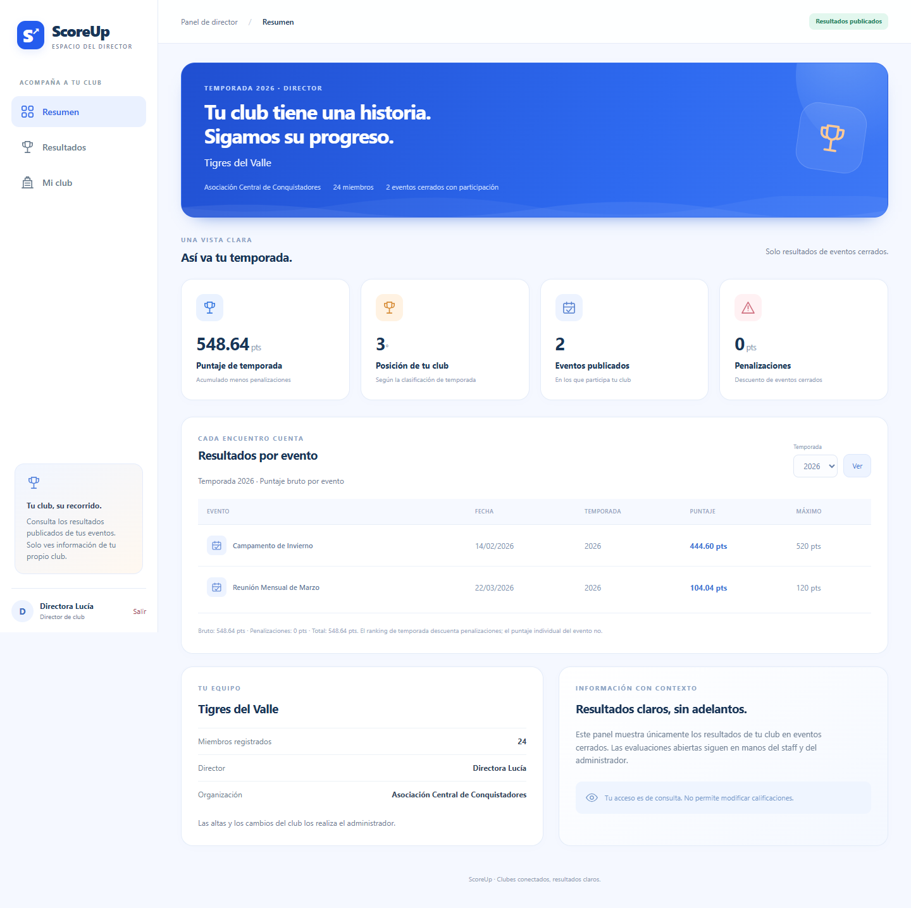

# ScoreUp — Evaluación Final del Proyecto Integrador

**ScoreUp** es un sistema web para gestionar clubes, miembros, eventos, evaluaciones QR, incidentes, penalizaciones y rankings, con exportación a Excel/PDF y proyección de resultados en pantalla. Una computadora ejecuta la aplicación con SQLite y atiende a tres roles: Administrador, Staff y Director de club.

**Equipo:** Juan Fernando Nina Cachi · Kevin Quispe Canaviri · Erick Lanchimba Lanchimba  
**Asignatura:** Taller de Programación · **Docente:** Victor Hugo Sarzuri Flores  
**Entrega:** 27 de noviembre de 2026 · **Repositorio:** https://github.com/JuanFernandoNina/scoreup  
**Demo pública:** https://scoreup-beta.vercel.app/  
**Documento final:** [Evaluación por criterios](documents/DOCUMENTO_FINAL_EVALUACION.md)

> **Instalación mínima:** instala **Python 3.12**, crea `.venv`, ejecuta `pip install -r requirements-local.txt` y abre **`INICIAR.bat`**. La aplicación queda en **http://localhost:5000**. Los pasos completos están en la sección 1.

**Puedes usarlo sin internet después de instalarlo.** Una computadora guarda los datos en SQLite y sirve la aplicación al navegador. Los celulares se conectan a esa computadora por Wi-Fi local: no necesitan datos móviles, Vercel ni Supabase.

> Descarga el proyecto, Python y las dependencias **antes** de salir a un lugar sin señal. Descargar únicamente el ZIP de GitHub no incluye Python ni los paquetes necesarios. La copia local no descarga ni sincroniza automáticamente los datos de la web pública.

## Criterios de evaluación

| Criterio | Puntaje | Evidencia en este repositorio |
|---|---:|---|
| 1. Presentación y Documento Final | 15 | Este README y el [documento final por criterios](documents/DOCUMENTO_FINAL_EVALUACION.md). |
| 2. Funcionamiento del Sistema en Vivo (MVP) | 30 | Capturas siguientes, [guía de prueba con QR](documents/GUIA_PRUEBAS_QR.md) e instrucciones de instalación. |
| 3. Arquitectura, SOLID y Patrones | 15 | Sección de arquitectura del [documento final](documents/DOCUMENTO_FINAL_EVALUACION.md) y [diagramas del flujo QR](documents/DIAGRAMA_QR.md). |
| 4. Uso Crítico de IA y Calidad Técnica | 15 | Sección de IA y calidad del [documento final](documents/DOCUMENTO_FINAL_EVALUACION.md), pruebas en `tests/` y guías técnicas. |
| 5. Defensa Oral y Ronda de Preguntas | 25 | Guion y preguntas probables en el [documento final](documents/DOCUMENTO_FINAL_EVALUACION.md). |

## Capturas del sistema

Las imágenes se generaron con datos ficticios en una base temporal; no modifican la base de la instalación local.

### Portada


### Panel del Administrador


### Panel del Staff


### Panel del Director



## 1. Descargar el proyecto

1. Abre [github.com/JuanFernandoNina/scoreup](https://github.com/JuanFernandoNina/scoreup).
2. Pulsa **Code → Download ZIP**.
3. Extrae todo el ZIP en una carpeta con permisos de escritura, por ejemplo `Documentos\scoreup`. No ejecutes archivos dentro del ZIP.
4. Abre esa carpeta en el Explorador y selecciona **Abrir en Terminal** (PowerShell). Debes ver `app.py`, `requirements-local.txt` e `INICIAR.bat`.

También puedes usar Git:

```powershell
git clone https://github.com/JuanFernandoNina/scoreup.git
cd scoreup
```

## 2. Instalar Python y dependencias (una sola vez, con internet)

### Windows — recomendado

Instala **Python 3.12 de 64 bits** desde [python.org](https://www.python.org/downloads/). Marca **Add Python to PATH**. Cierra y vuelve a abrir la terminal después de instalarlo.

Desde la carpeta de ScoreUp:

```powershell
py -3.12 -m venv .venv
.\.venv\Scripts\python.exe -m pip install -r requirements-local.txt
```

No necesitas activar el entorno, Node, PostgreSQL, Docker, una cuenta Supabase ni un archivo `.env`. La instalación local usa SQLite por defecto. `requirements-local.txt` instala también OpenCV para leer imágenes QR sin descargar modelos.

### Linux / macOS

Usa Python 3.12 o 3.13. En Linux puede ser necesario instalar el paquete `python3-venv` del sistema.

```bash
python3 -m venv .venv
.venv/bin/python -m pip install -r requirements-local.txt
```

## 3. Preparar tus accesos

### Opción A: probar con clubes y resultados de demostración

**Antes del primer inicio**, ejecuta:

```powershell
.\.venv\Scripts\python.exe scripts\preparar_demo.py
```

En Linux/macOS sustituye `.\.venv\Scripts\python.exe` por `.venv/bin/python`.

El asistente pide contraseñas propias para Admin, Staff y Director; no se muestran al escribir. Usa contraseñas distintas por rol. Las cuentas de cada rol compartirán la contraseña que elijas para ese rol: esta opción es para demostración, no para accesos reales de un campamento.

| Rol | Usuario principal |
|---|---|
| Administrador | `admin.campamento` |
| Staff | `staff.campamento` |
| Director | `director.campamento` |

Los datos incluidos están anonimizados; no contienen contraseñas originales ni fotos personales. El asistente **no reemplaza una base existente**. Más detalles en [demo/LEEME.md](demo/LEEME.md).

### Opción B: comenzar con tu propia organización

Inicia ScoreUp y abre **Registro** para crear tu cuenta Admin y tu organización. Desde tu panel crea clubes, eventos, criterios y accesos de Staff/Director.

Si no preparaste la demo, el primer arranque genera ejemplos básicos separados de tu nueva organización. No uses sus cuentas de ejemplo para una instalación pública. Con Docker la instalación nueva comienza vacía.

## 4. Iniciar ScoreUp

### Windows

Haz doble clic en **`INICIAR.bat`**. También puedes ejecutarlo desde PowerShell:

```powershell
.\INICIAR.bat
```

Mantén abierta la ventana. Abre **http://localhost:5000** en el navegador. El lanzador muestra también una dirección para los celulares.

### Linux / macOS

```bash
.venv/bin/python app.py
```

Abre **http://localhost:5000**. Para detener en cualquier sistema, pulsa **Ctrl+C** en la terminal del servidor. Para volver a usarlo mañana, inicia de nuevo: **no reinstales dependencias ni recrees la base**.

## 5. Conectar celulares sin internet

1. Conecta la computadora y los celulares al mismo router Wi-Fi. El router puede funcionar sin conexión a internet. Una zona Wi-Fi también puede servir si permite comunicación entre dispositivos.
2. Ejecuta `INICIAR.bat` en la computadora y déjala encendida, conectada y sin suspensión.
3. En cada celular abre la dirección mostrada, por ejemplo **`http://192.168.1.20:5000`**. Sustituye la IP por la de tu computadora; `localhost` en un teléfono apunta al teléfono, no a la computadora.
4. Si Windows pide permiso de firewall, permite Python únicamente en **redes privadas de confianza**. No desactives todo el firewall ni abras puertos del router hacia internet.
5. Si no aparece una dirección, consulta `ipconfig` (Windows) y busca la IPv4 del adaptador Wi-Fi. Puedes iniciar con una dirección explícita:

```powershell
$env:PUBLIC_BASE_URL = "http://192.168.1.20:5000"
.\INICIAR.bat
```

En Linux/macOS: `PUBLIC_BASE_URL=http://192.168.1.20:5000 .venv/bin/python app.py`.

**Sin señal móvil está bien; sin una red entre los dispositivos no podrán comunicarse.** Si la red aísla clientes (habitual en Wi-Fi de invitados), cambia de red o desactiva ese aislamiento con autorización. La IP puede cambiar: revisa la dirección de los QR en **Clubes → QR del club** antes de imprimirlos.

## 6. Usar QR y proyectar resultados

- **Admin:** crea eventos, criterios que sumen 100 %, clubes participantes y usuarios Staff; descarga las tarjetas QR. Cada Staff tiene un evento asignado.
- **Staff:** abre **Escanear QR de un club → Activar cámara** para tomar una foto, o **Elegir imagen del QR** para usar un PNG/galería. El lector del navegador (jsQR) y OpenCV son locales y no necesitan internet.
- La casilla de lectura avanzada puede seguir indicando QReader: con la instalación básica, el servidor usa OpenCV como alternativa. QReader es opcional, no necesario para iniciar.
- El vídeo en vivo necesita HTTPS o localhost compatibles. En un celular conectado por `http://IP:5000`, usa foto/galería; instalar paquetes no elimina esa restricción del navegador.
- Los QR de Vercel o de otra instalación no sustituyen las tarjetas locales: cada instalación tiene su propia clave y datos. Genera los QR en esta copia.
- **Director:** consulta su club y descarga su QR; los resultados se publican al cerrar el evento.
- **Admin → Proyectar resultados:** selecciona el ranking y pulsa **Proyectar a pantalla completa**. El podio y la clasificación no necesitan internet. Sal con **Esc**; la vista no se actualiza automáticamente.

Más ayuda de QR: [documents/GUIA_PRUEBAS_QR.md](documents/GUIA_PRUEBAS_QR.md).

## 7. Preparar una instalación completamente sin conexión

Lo más sencillo es **instalar y probar en la computadora del campamento mientras todavía tienes internet**. Después solo necesitas `INICIAR.bat`.

Si necesitas instalar los paquetes más tarde sin conexión, en una computadora con **el mismo sistema operativo, arquitectura y versión de Python** descarga también el instalador de Python y los paquetes:

```powershell
py -3.12 -m venv .venv
.\.venv\Scripts\python.exe -m pip download --only-binary=:all: -r requirements-local.txt -d paquetes-offline
```

Lleva por USB la carpeta completa del proyecto, `paquetes-offline` y el instalador de Python. No copies `.venv` entre computadoras: créalo en la de destino. Ya sin internet:

```powershell
py -3.12 -m venv .venv
.\.venv\Scripts\python.exe -m pip install --no-index --find-links=paquetes-offline -r requirements-local.txt
.\.venv\Scripts\python.exe scripts\preparar_demo.py
.\INICIAR.bat
```

La preparación demo es opcional y solo se hace si todavía no existe `scoreup.db`. En Linux/macOS usa los comandos equivalentes de su entorno. Los paquetes descargados para Windows no sirven automáticamente para Linux/macOS u otra versión de Python.

CSS, iconos y JavaScript se incluyen en `static/`; no hay que compilar ni descargar estilos al abrir la web. No dependas de Google Lens ni de servicios externos para el uso offline.

### QReader avanzado (opcional)

Para fotos difíciles puedes instalar QReader mientras tienes internet. Descarga modelos la primera vez y requiere más espacio y dependencias que OpenCV:

```powershell
.\.venv\Scripts\python.exe -m pip install -r requirements-qr.txt
.\.venv\Scripts\python.exe -c "from qr_reader import get_reader; from qreader import QReader; print(type(get_reader()).__name__)"
```

Antes de salir, confirma que devuelve `QReader` y prueba una foto real. Si aparece `_OpenCVReader`, estás usando el fallback, no el modelo avanzado. En Windows, pyzbar puede requerir el [runtime oficial Visual C++ 2013 x64](https://www.microsoft.com/en-us/download/details.aspx?id=40784); en Linux requiere `libzbar0` y bibliotecas de OpenCV. No borres la caché de modelos (`~/.cache/scoreup/qreader`) si necesitas QReader offline.

## 8. Guardar y respaldar datos

Detén el servidor antes de copiar. Guarda juntos y de forma privada:

- **`scoreup.db`**: usuarios, clubes, eventos y resultados.
- **`.secret_key`**: clave de sesiones y firma QR. No la borres ni la publiques.
- **`static/uploads/`**: fotos de incidentes.

Para restaurar, con el servidor detenido coloca esos mismos archivos en la misma ubicación de una copia compatible del proyecto. La demo y GitHub **no son respaldos de tu instalación**. Descargar nuevamente el proyecto no recupera tus datos. No subas bases personales, claves, `.env` ni fotos privadas a GitHub.

## Problemas frecuentes

| Problema | Solución |
|---|---|
| `py` no se reconoce | Reinstala Python con PATH y abre una terminal nueva. Usa Python 3.12/3.13; no una versión experimental. |
| No existe `.venv` / falta un módulo | Completa el paso 2 dentro de la carpeta extraída, o instala desde `paquetes-offline`. |
| Error de política PowerShell | Usa `INICIAR.bat`; no requiere activar `.venv` ni cambiar permanentemente la política. |
| Puerto 5000 ocupado | Cierra la instancia anterior. Alternativa: `$env:PORT="5002"` y vuelve a iniciar; usa ese puerto en teléfonos y QR. |
| El celular no abre la página | Revisa IP, Wi-Fi compartida, red privada, firewall y aislamiento de clientes. Mantén la laptop despierta. |
| QR inválido | Usa un QR de esta instalación, conserva `.secret_key` y comprueba que el club participa en el evento del Staff. |
| No aparece la cámara en vivo | En HTTP por IP utiliza foto/galería. |
| Intenta conectar a Supabase | Quita de esta terminal `SCOREUP_DB_BACKEND`, `VERCEL` y `PUBLIC_BASE_URL` heredados del cloud. No importes el `.env` de Vercel. |
| La demo dice que ya existe la base | Es una protección: no borres tus datos. Continúa con tu base existente o prepara la demo en otra carpeta extraída. |

## Otras opciones

- **Documento final:** [evaluación por los cinco criterios](documents/DOCUMENTO_FINAL_EVALUACION.md).

- **Docker:** [guía de instalación, persistencia y uso](documents/DOCKER.md). Con Docker Desktop instalado: `docker compose up -d --build`; abre `http://localhost:5001` y registra tu organización. Construye/descarga la imagen con internet antes del campamento. No uses `docker compose down -v`: elimina el volumen de datos.
- **Web pública:** [https://scoreup-beta.vercel.app/](https://scoreup-beta.vercel.app/) — Vercel + Supabase. Requiere internet; no es necesaria para los pasos locales anteriores. Guía técnica: [Vercel + Supabase](documents/VERCEL.md).
- **Pruebas:** `.\.venv\Scripts\python.exe -m unittest discover -s tests -p "test_*.py" -v` usa bases temporales y no modifica la tuya.
- **Desarrollo de estilos:** los CSS ya están compilados. Solo al modificar clases Tailwind: `npm exec --yes --package=tailwindcss@3.4.17 -- tailwindcss -i static/admin-utilities.src.css -o static/app-utilities.css --content './templates/**/*.html' --minify`. El layout Admin tiene además su compilación `admin-utilities.css`.

El servidor integrado es para uso académico en redes locales de confianza, no para exponerlo directamente a internet. Cada computadora servidora tiene una base independiente: mantén **un solo servidor** como fuente de los datos del evento. Prueba foto/cámara en los teléfonos y el respaldo/restauración antes de depender del sistema en un campamento real.

## Equipo

Juan Fernando Nina Cachi · Kevin Quispe Canaviri · Erick Lanchimba Lanchimba.

Proyecto académico de Taller de Programación. Uso educativo, sin fines comerciales.
