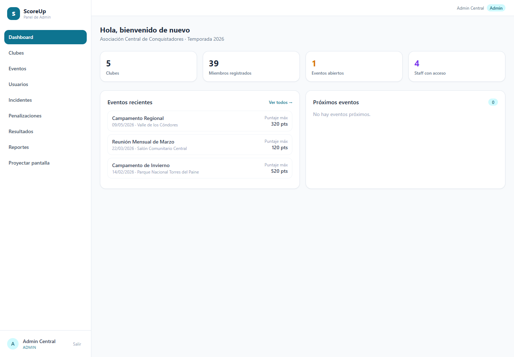
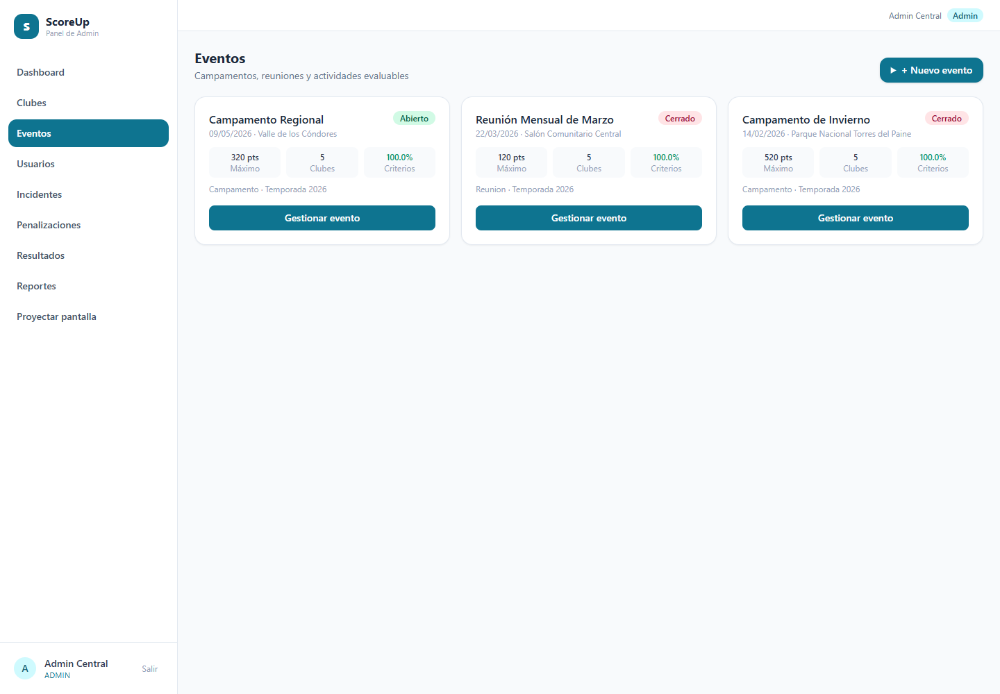
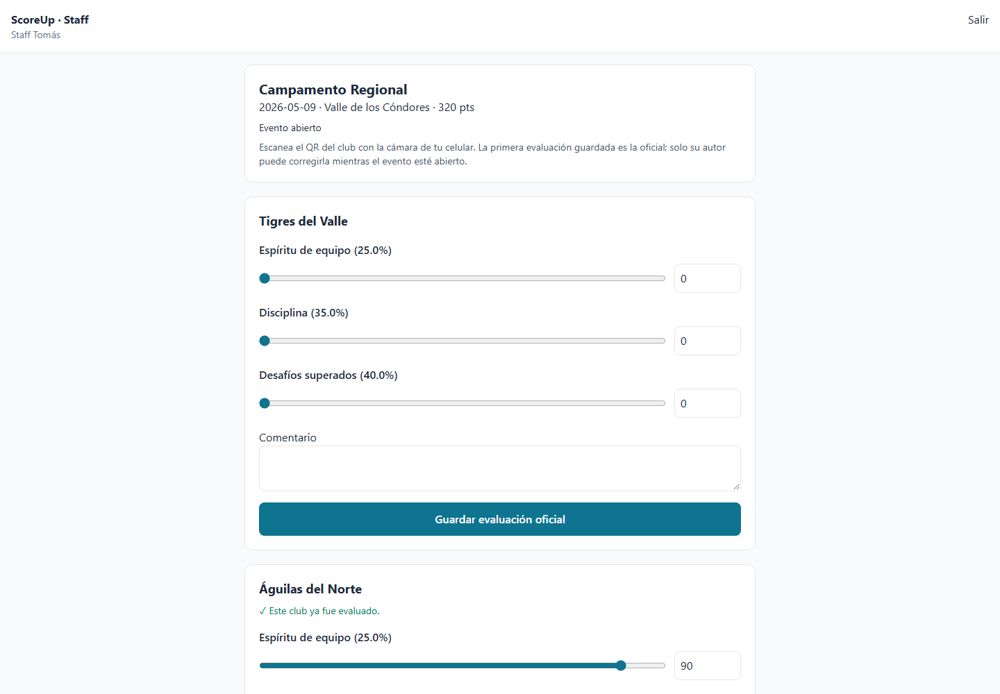

# Guía de uso

## Acceso inicial

Inicia ScoreUp siguiendo [Instalación](instalacion.md) y abre
`http://127.0.0.1:5000`. Puedes registrar una organización con su administrador
inicial o utilizar una cuenta local autorizada. No publiques credenciales.

## Administrador

*Panel administrativo con datos de demostración.*

1. En **Clubes**, registra los clubes de la organización y sus miembros.
2. En **Eventos**, crea el evento con temporada y puntaje máximo.
3. Añade los criterios y verifica que sus pesos sumen **100 %**.
4. Incorpora los clubes participantes antes de comenzar las evaluaciones.
5. Crea o genera usuarios staff para ese evento y directores para los clubes.
6. Desde la opción QR del club, descarga o imprime la tarjeta de acceso.
7. Supervisa las evaluaciones, los incidentes y las penalizaciones.
8. Revisa en **Reportes** los avisos generados por correcciones de notas.
9. Cuando todos los participantes tengan nota oficial, cierra el evento.
10. Consulta resultados y exporta los rankings a Excel o PDF.

!!! warning "Antes de evaluar"
    Revisa criterios y participantes antes de empezar: se bloquean cuando
    existen evaluaciones oficiales. Un evento cerrado no admite cambios.

*Listado de eventos y opciones de gestión del administrador.*

## Staff evaluador

*Vista del staff asignado a un evento abierto. No se enviaron evaluaciones
para generar esta captura.*

1. Inicia sesión con la cuenta asignada al evento.
2. Abre el panel o escanea el QR del club con la cámara del celular.
3. Si el QR solicita iniciar sesión, el sistema conserva el retorno al club.
4. Introduce una nota de **0 a 100** para cada criterio y un comentario opcional.
5. Guarda y comprueba el mensaje de confirmación.
6. Si detectas un error, corrige tu evaluación mientras el evento esté abierto.

La primera evaluación guardada es la oficial. Otro evaluador no puede
reemplazarla. Si el formulario quedó desactualizado, recarga la página antes
de intentar corregirlo. Las correcciones generan un aviso al administrador.

El staff también puede reportar incidentes con evidencia y aplicar
penalizaciones según el catálogo disponible.

## Prueba del QR con celular

- Conecta el equipo y el celular a la misma red de confianza.
- Abre ScoreUp en el equipo utilizando su **IP local**, por ejemplo
  `http://192.168.1.20:5000`, antes de generar la tarjeta QR.
- También puede configurarse `PUBLIC_BASE_URL` con la dirección accesible.
- No uses `127.0.0.1` en el QR: en el teléfono apuntaría al propio teléfono.
- Si no conecta, revisa la IP, el puerto y las reglas del firewall, sin
  desactivar la protección general del sistema.

!!! note "Red local"
    El servidor de desarrollo de Flask no es un servidor de producción.
    La documentación MkDocs escucha solamente en el equipo local y no
    necesita exponerse al teléfono para probar las evaluaciones.

## Director de club

1. Inicia sesión con una cuenta de director vinculada al club.
2. Selecciona la temporada disponible.
3. Consulta los puntajes y la posición de tu club.

El director recibe resultados de eventos cerrados, no el panel administrativo
ni las evaluaciones provisionales completas de otros clubes.

## Problemas frecuentes

| Situación | Revisión recomendada |
| --- | --- |
| `mkdocs` no se reconoce | Activa `venv` o usa su `python.exe -m mkdocs`. |
| El sitio no abre en 8000 | La documentación usa **8080**. |
| Staff sin evento | El administrador debe asignarle un evento. |
| No se puede cerrar | Revisa pesos y notas oficiales de todos los participantes. |
| Conflicto al guardar | Puede existir otra evaluación, una versión antigua o un evento cerrado. |
| Error CSRF | Recarga el formulario y vuelve a enviarlo con una sesión válida. |
| Director sin resultados | Verifica temporada, club asignado y eventos cerrados. |
