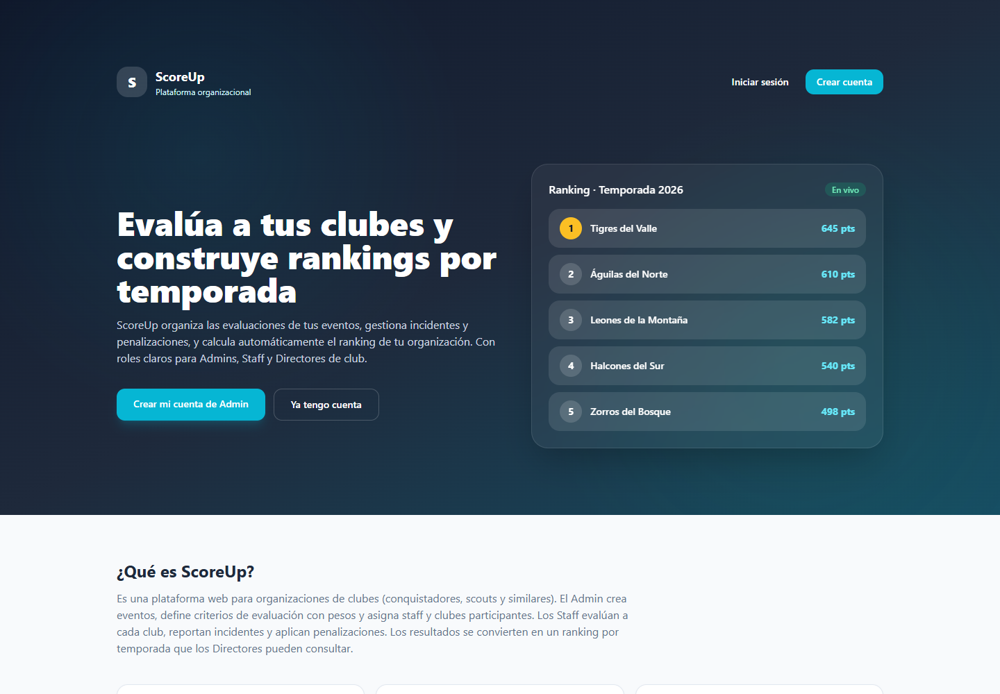

# Documentación de ScoreUp

**ScoreUp** es una aplicación web para registrar y evaluar el desempeño de
clubes de Conquistadores en eventos y temporadas. Este sitio forma parte del
laboratorio de **Taller de Programación** y está construido con **MkDocs** y
el tema **Material**.

## Problema que resuelve

*Figura 1. Página principal de la aplicación ejecutada localmente. El ranking
de esta portada es ilustrativo.*

La información dispersa en planillas dificulta comparar resultados y mantener
un historial de evaluaciones. ScoreUp centraliza clubes, participantes,
criterios, notas, incidentes y penalizaciones en una aplicación con acceso por rol.

## Características principales

- Gestión de organizaciones, clubes, miembros y usuarios.
- Eventos con criterios ponderados y puntaje máximo configurable.
- Acceso al club mediante QR y una evaluación oficial por club y evento.
- Correcciones de notas por su autor, con avisos para el administrador.
- Registro de incidentes con evidencia y aplicación de penalizaciones.
- Rankings por evento y temporada, exportables a Excel y PDF.
- Consulta de resultados publicados para el director de cada club.

## Recorrido de la documentación

| Sección | Contenido |
| --- | --- |
| [Instalación y requisitos](instalacion.md) | Entornos virtuales, instalación, servidor y compilación. |
| [Arquitectura](arquitectura.md) | Componentes, datos y reglas del sistema. |
| [Guía de uso](guia-uso.md) | Flujo del administrador, staff y director. |
| [API / Módulos](api.md) | Funciones, rutas HTTP y pruebas disponibles. |

!!! warning "Alcance académico"
    ScoreUp es una versión para pruebas locales. Publicar esta documentación
    estática no publica la aplicación Flask ni su base de datos. Un despliegue
    real requiere medidas adicionales de seguridad y un servidor adecuado.

## Equipo

- Juan Fernando Nina Cachi.
- Axel Alberto Ticona Villegas.
- Kevin Quispe Canaviri.
- Erick Lanchimba Lanchimba.
