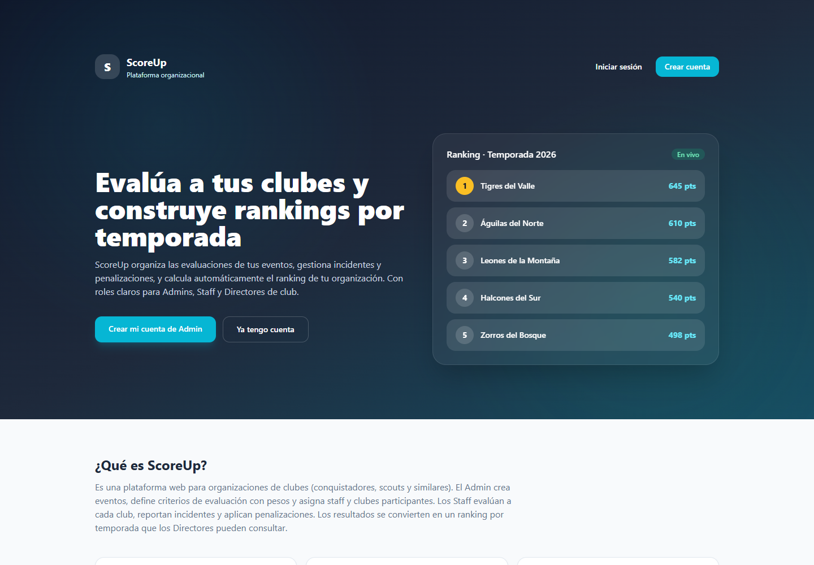
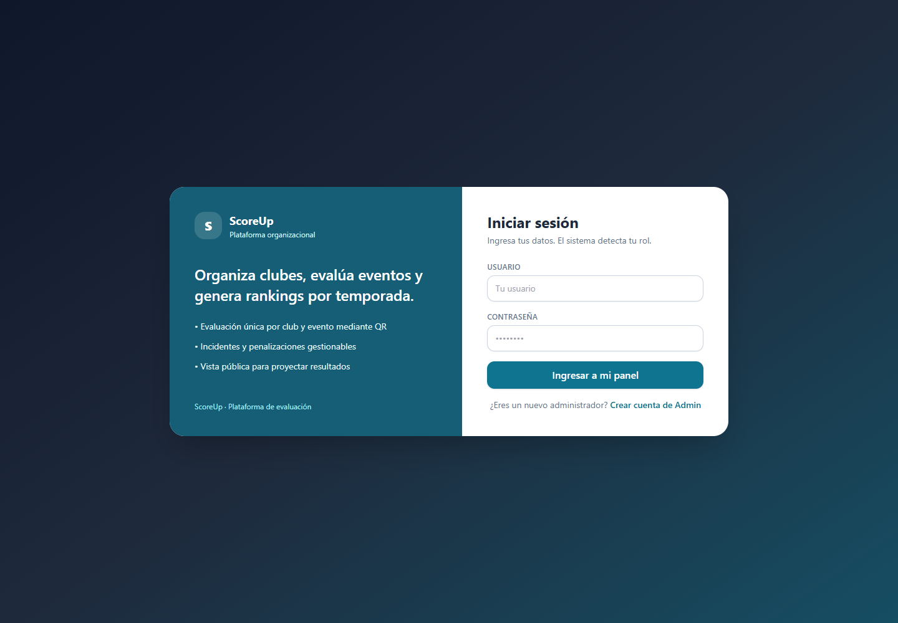
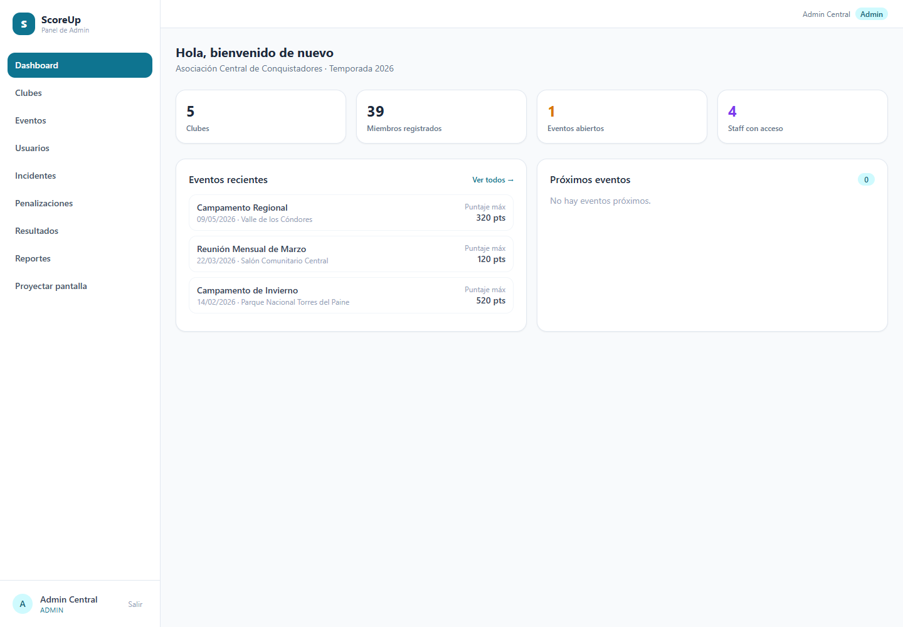
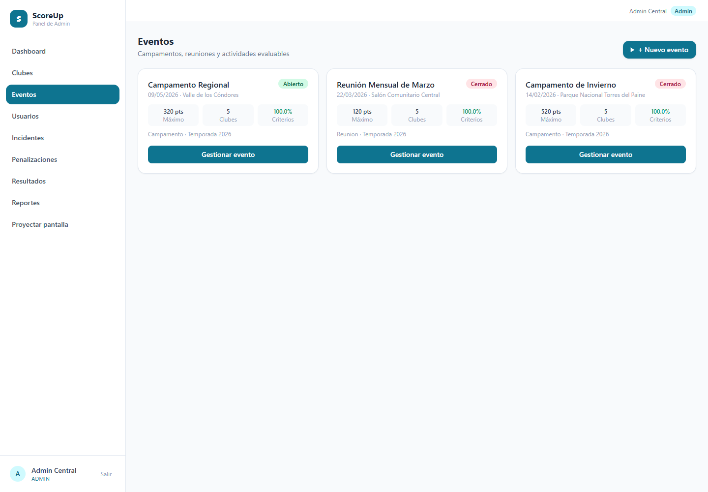
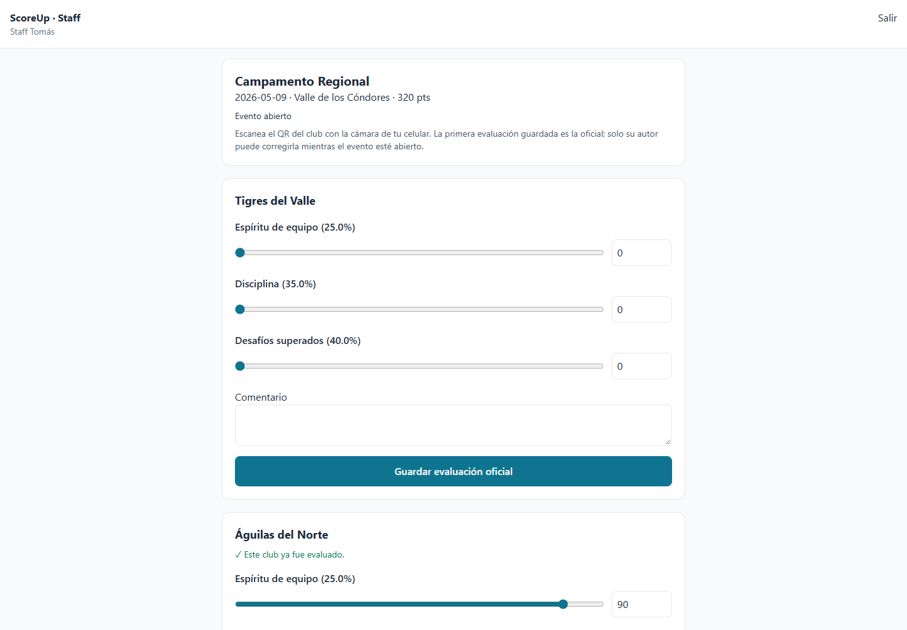

# Recursos multimedia — actividad 4.2

## Objetivo

Incorporar imágenes del proyecto en `docs/assets/images/` y utilizarlas en
los documentos Markdown, como solicita el apartado 4.2 de la guía.

## Capturas del proyecto en ejecución

Las siguientes capturas se tomaron el **2026-10-28** con ScoreUp ejecutándose
localmente, usando Microsoft Edge en una ventana de **1440 × 1000 píxeles**.
Se utilizó una base SQLite separada con los datos de demostración del
proyecto, no la base de trabajo. No se incluyen credenciales ni información
real de usuarios.

### 1. Página principal



Presenta la finalidad de la aplicación, sus accesos y un ranking ilustrativo.
También se incluye en la página [Inicio](index.md).

### 2. Inicio de sesión



Formulario de acceso sin credenciales introducidas. El sistema dirige al
usuario al panel correspondiente según su rol.

### 3. Panel del administrador



Muestra el resumen de clubes, miembros, eventos abiertos y personal evaluador.
Se incorpora también a la [Guía de uso](guia-uso.md).

### 4. Gestión de eventos



Permite consultar los eventos y acceder a su configuración.

### 5. Panel del staff



Muestra los criterios y el acceso a la evaluación de los clubes participantes.
Para tomar las capturas no se enviaron notas ni se alteraron los eventos.

## Organización de archivos

```text
docs/
├── index.md
├── guia-uso.md
├── recursos-multimedia.md
└── assets/
    └── images/
        ├── scoreup-inicio.png
        ├── scoreup-login.png
        ├── scoreup-admin.png
        ├── scoreup-eventos.png
        └── scoreup-staff.png
```

## Inclusión en Markdown

Cada imagen se incorpora con una ruta relativa y un texto alternativo que
describe su contenido:

```markdown

```

MkDocs copia automáticamente estos recursos a `site/assets/images/` al
ejecutar `mkdocs build`. Material adapta las imágenes al ancho disponible.
