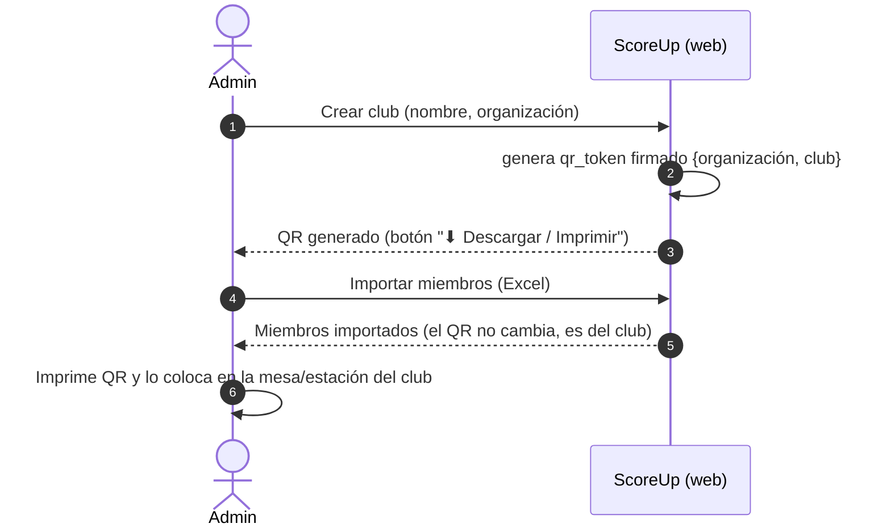
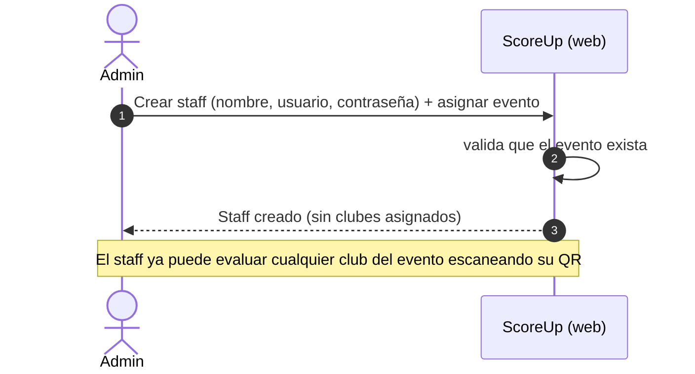
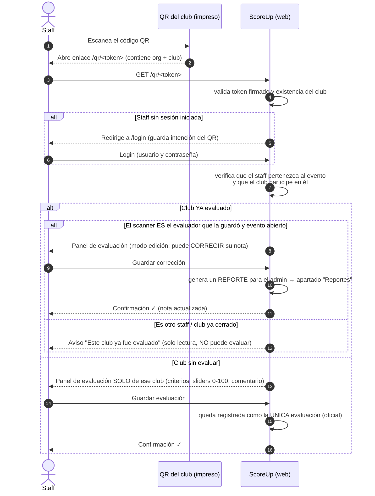
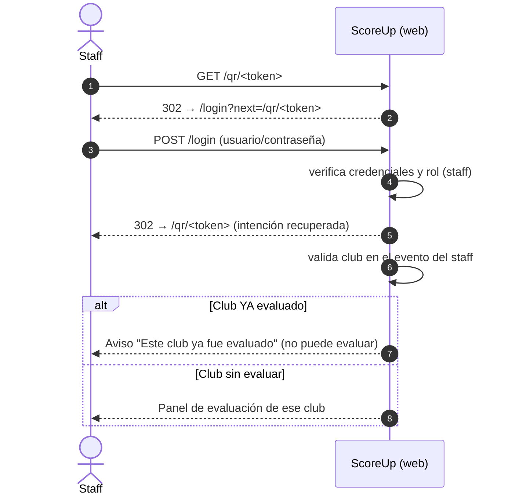
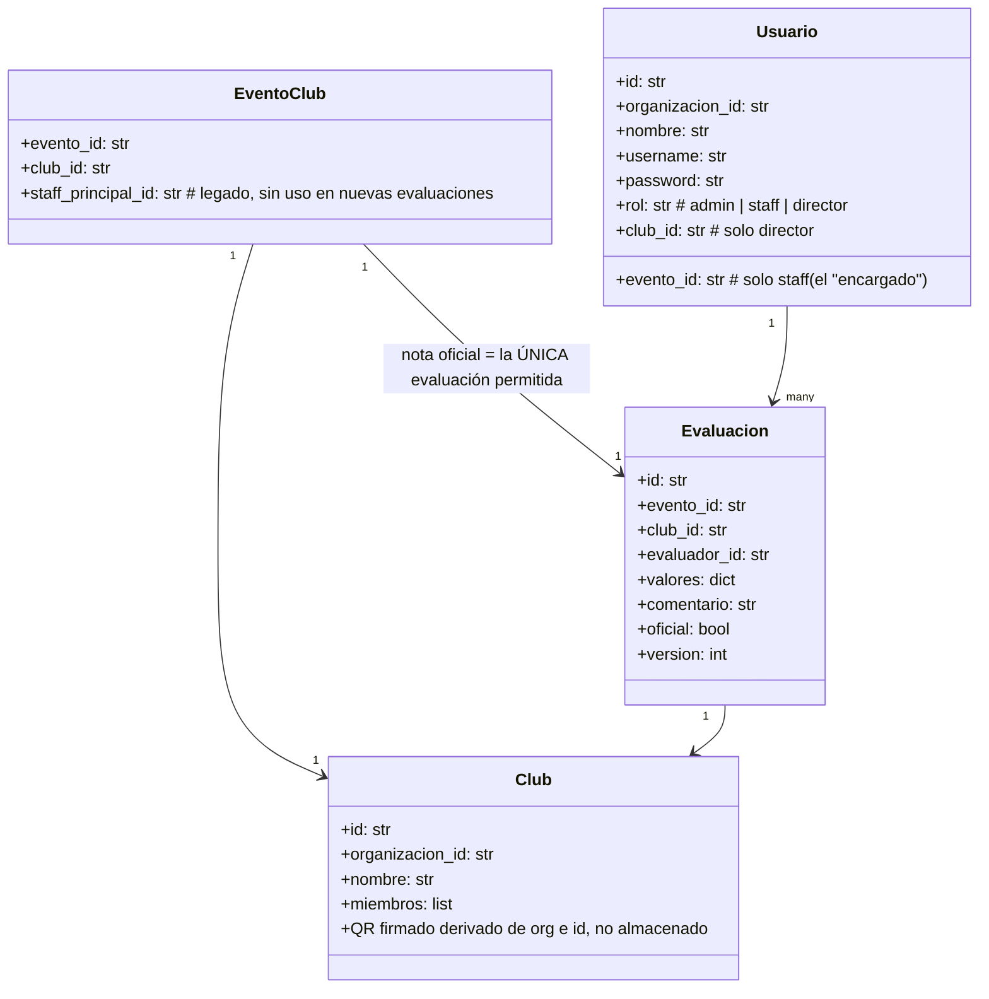

# ScoreUp — Manejo de QR por club (Diagramas de secuencia)

**Estado:** implementado para pruebas locales · **Válido para:** escenario "evento grande" donde asignar clubes a cada staff es tedioso.

La cámara normal del celular abre el enlace firmado. Ver [GUIA_PRUEBAS_QR.md](GUIA_PRUEBAS_QR.md) para iniciar el servidor y probar. El esquema conserva `staff_principal_id` solo por compatibilidad histórica; ya no se usa para decidir la nota oficial. Los respaldos antiguos se conservan con `oficial=False`, y SQLite impone una única nota oficial por club/evento. Los tokens son estables por club: el evento cerrado impide escrituras, pero no invalida el QR para eventos futuros.

## Cambio de flujo (resumen)

| | Antes | Ahora |
|---|---|---|
| Club ↔ Staff | Admin asigna `staff_principal_id` a cada club del evento | El QR del club identifica a qué club evaluar |
| Creación de staff | Se asigna nombre, usuario, contraseña y clubes | Solo nombre, usuario, contraseña y evento |
| Evaluación | El staff entra al panel y elige/clica el club | El staff **escanea el QR** del club y evalúa ese club |
| Evaluación oficial | Solo la del staff principal | El club se evalúa **una sola vez** (quien escanea y guarda primero) |
| Total temporada | Σ puntajes de eventos − penalizaciones | **Sin cambios** (se mantiene la fórmula) |

---

## Diagrama de secuencia 1 — Admin: crear club y generar su QR

---

## Diagrama de secuencia 2 — Admin: crear staff (sin asignar clubes)

---

## Diagrama de secuencia 3 — Staff: escanear QR y evaluar el club

---

## Diagrama de secuencia 3b — Variante: staff sin sesión (login + retorno al QR)

---

## Diagrama de clases / modelo de datos (cambios)

---

## Rutas nuevas / modificadas

| Ruta | Método | Descripción |
|---|---|---|
| `/qr/<token>` | GET | Valida token, gestiona login pendiente y redirige al panel enfocado |
| `/admin/clubes/<id>/qr` | GET | Descarga/imprime la tarjeta QR del club |
| `/staff` | GET | Acepta `?club=<id>` para enfocar la evaluación de ese club |
| `POST /staff/evaluar/<club_id>` | POST | Sin cambios; el primer guardado marca notar oficial |

---

## Reglas de negocio que se mantienen / nuevas

1. La suma de pesos de criterios debe ser **100%** para cerrar un evento.
2. 🔒 **NUEVA:** Cada club solo puede ser evaluado **una sola vez**. Si el staff escanea y el club **ya fue evaluado**, no podrá evaluar (solo ve el aviso). El QR muestra 2 escenarios: *puede evaluar* (no evaluado aún) o *no puede evaluar* (ya evaluado).
3. La **única** evaluación guardada para un club es la oficial (alimenta el ranking). No hay respaldos ni "staff principal".
4. Empates en ranking de evento: se compara el criterio de mayor peso. En temporada, igualdad de total comparte posición.
5. **Duración del QR:** el QR es del club, no del staff ni del evento. Sigue válido mientras el club y la clave existan; cerrar un evento bloquea cambios, pero permite consultar y reutilizar el QR en otro evento.
6. **Total temporada = Σ puntajes de eventos − penalizaciones/sanciones** (fórmula final, sin cambios).
7. 🔔 **NUEVA (correcciones):** si el staff **corrige** su evaluación mientras el evento está **abierto**, el sistema genera **automáticamente una notificación en el apartado "Reportes"** del admin (club, staff, cambio, fecha). El admin puede **marcar revisado** o **descartar**. Esto NO altera la nota vigente ni el ranking: la nota oficial sigue siendo la única evaluación (la última corrección guardada).
8. Los criterios se congelan al empezar a evaluar. Para cerrar se requiere 100% de pesos y una evaluación oficial para cada participante.
9. La versión del formulario evita sobrescrituras con pestañas antiguas. La transacción SQLite serializa guardados y el índice único evita duplicados oficiales.
