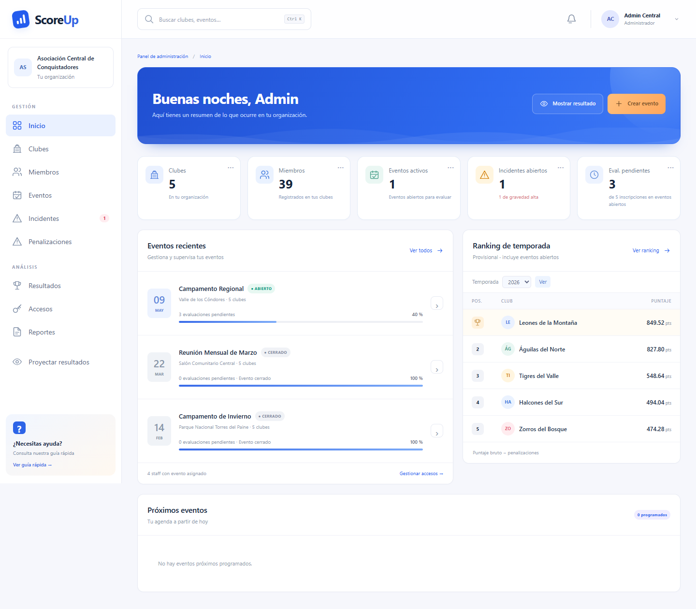
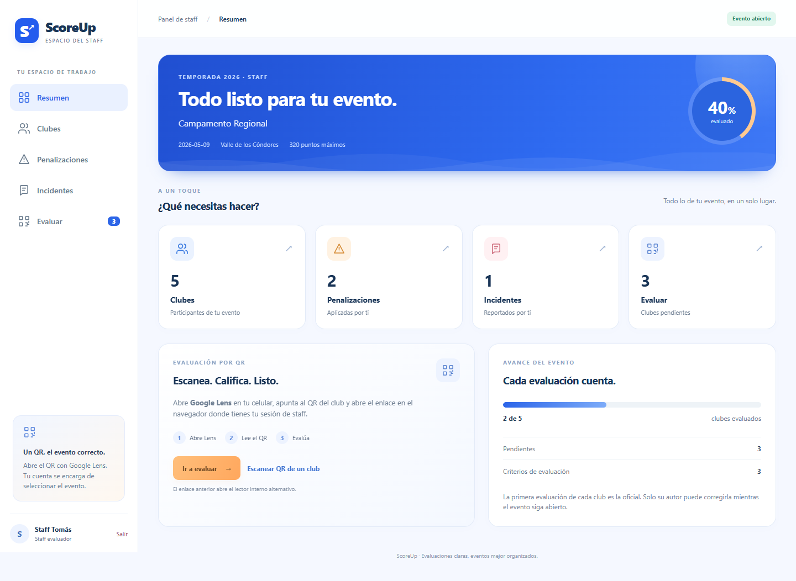
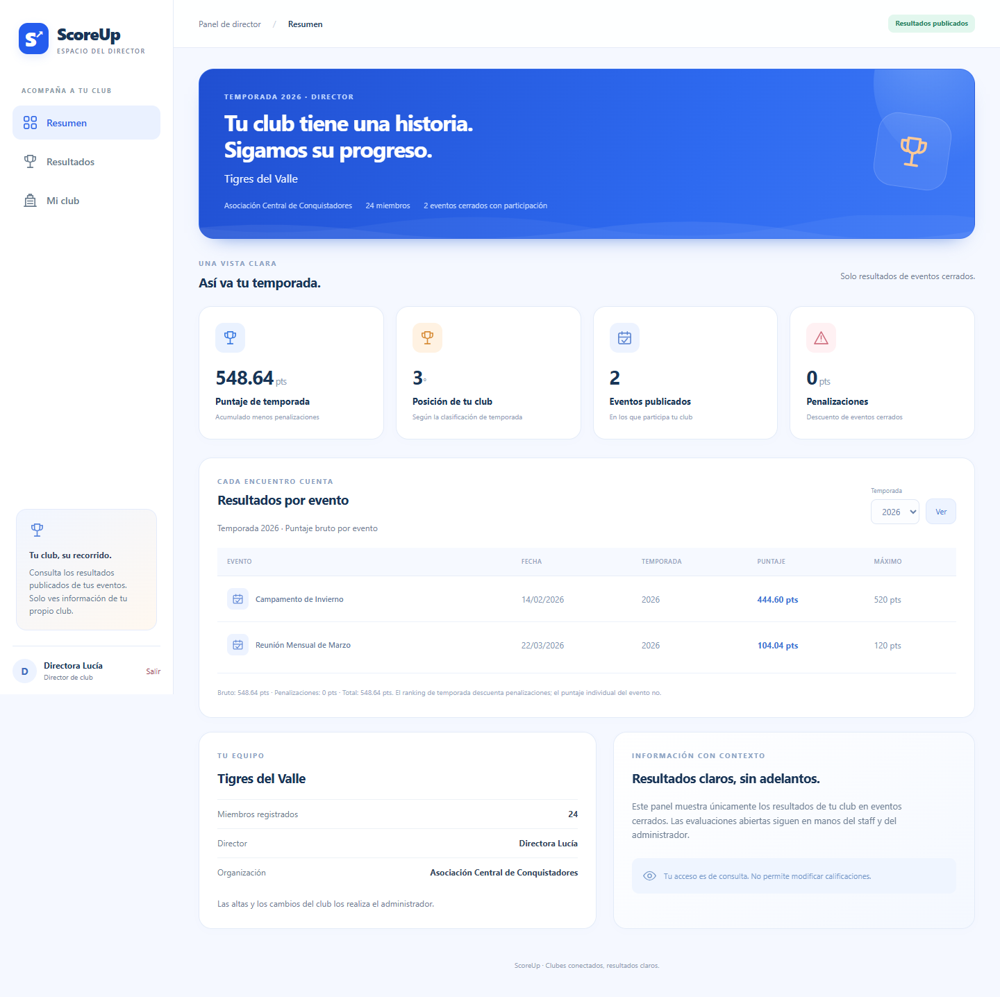

# ScoreUp — Documento final de la Evaluación del Proyecto Integrador

**Asignatura:** Taller de Programación  
**Docente:** Victor Hugo Sarzuri Flores  
**Proyecto:** ScoreUp — Sistema de evaluación de clubes mediante QR  
**Fecha de entrega:** 27 de noviembre de 2026  
**Repositorio:** https://github.com/JuanFernandoNina/scoreup  

## Integrantes

- Juan Fernando Nina Cachi
- Kevin Quispe Canaviri
- Erick Lanchimba Lanchimba

## Resumen ejecutivo

ScoreUp resuelve la evaluación manual de clubes en eventos y temporadas mediante una aplicación web local que centraliza clubes, miembros, criterios, evaluaciones, incidentes, penalizaciones y rankings. El sistema opera sin internet después de instalado: una computadora ejecuta el servidor con SQLite y los celulares acceden por Wi-Fi local. El flujo central usa un QR firmado por club: el Staff escanea la tarjeta, registra la nota única del club y el Administrador publica el ranking; el Director consulta solo los resultados de su club.

El proyecto se entrega con código fuente, guías de instalación y uso, capturas reales del sistema, pruebas automatizadas y este documento, organizado según los cinco criterios de la evaluación.

---

## Criterio 1 — Presentación y Documento Final (15 puntos)

La presentación del proyecto se organiza en tres niveles complementarios:

1. **Repositorio GitHub:** contiene el código, el README de presentación, las guías técnicas, las capturas y este documento.
2. **README:** presenta el problema, el equipo, los criterios de evaluación, las capturas del sistema y la instalación paso a paso.
3. **Documento final:** concentra la evidencia por criterio y sirve de guion para la defensa oral.

| Evidencia | Ubicación en el repositorio |
|---|---|
| Presentación general del sistema | `README.md` |
| Documento final por criterios | `documents/DOCUMENTO_FINAL_EVALUACION.md` |
| Guía de prueba con QR y celular | `documents/GUIA_PRUEBAS_QR.md` |
| Diagramas del flujo QR | `documents/DIAGRAMA_QR.md` |
| Instalación local sin internet | `README.md`, secciones 1 a 7 |
| Despliegue opcional con Docker | `documents/DOCKER.md` |
| Despliegue opcional en la nube | `documents/VERCEL.md` |
| Capturas del sistema | `image/landing-page.png`, `image/dashboard-admin.png`, `image/dashboard-staff.png`, `image/dashboard-director.png` |

La documentación distingue claramente la operación local, que es la necesaria para el campamento, de las opciones Docker y Vercel/Supabase, que son despliegues alternativos y no sustituyen a la instalación sin conexión.

---

## Criterio 2 — Funcionamiento del Sistema en Vivo (MVP) (30 puntos)

### 2.1 Funcionalidades del MVP

- **Administrador:** registra la organización, crea clubes, miembros, eventos, criterios con pesos, cuentas de Staff y Director, motivos de penalización, tarjetas QR, reportes y exportaciones.
- **Staff:** inicia sesión, abre el QR de un club, registra o corrige la evaluación con valores por criterio y comentario, reporta incidentes con evidencia fotográfica y aplica penalizaciones.
- **Director:** consulta el puntaje y la posición de su propio club, descarga su QR y revisa resultados de eventos cerrados.
- **Reglas de negocio:** los pesos de los criterios deben sumar 100 % para cerrar un evento; cada club tiene una sola evaluación oficial; el desempate por evento usa el criterio de mayor peso; la temporada descuenta penalizaciones; las correcciones del Staff generan un reporte para el Administrador.
- **Operación sin internet:** CSS, JavaScript e imágenes son locales; la lectura QR funciona con OpenCV o jsQR sin depender de servicios externos.
- **Proyección:** la vista de resultados muestra podio, empates y clasificación en pantalla completa, sin actualización automática ni dependencias externas.

### 2.2 Flujo de demostración en vivo

1. **Iniciar el sistema.** Desde la carpeta del proyecto, ejecutar `INICIAR.bat` y abrir `http://localhost:5000`.
2. **Preparar datos de prueba.** Ejecutar `scripts/preparar_demo.py` antes del primer inicio si se desean clubes y resultados de demostración con contraseñas elegidas en el momento.
3. **Configurar el evento como Administrador.** Crear un evento con puntaje máximo 100 y criterios de 40 %, 40 % y 20 %. Registrar dos clubes, dos cuentas Staff asignadas al evento y un Director para el Club A.
4. **Generar las tarjetas QR.** En `Clubes → QR del club`, descargar o mostrar el QR de cada club. Comprobar que el enlace use la dirección de la computadora servidora, no `localhost`.
5. **Evaluar con el Staff.** Escanear el QR del Club A con la cámara del celular o con `Activar cámara`. Iniciar sesión como Staff si el navegador lo solicita. Registrar 80, 90 y 100 en los criterios: el sistema calcula **88 puntos**.
6. **Verificar unicidad y corrección.** Intentar evaluar el Club A con otro Staff: el sistema indica que ya fue evaluado. Volver como el Staff original, corregir una nota mientras el evento está abierto y comprobar que aparece el aviso en `Reportes` del Administrador.
7. **Publicar resultados.** Cerrar el evento, entrar como Director para consultar su club y usar `Proyectar a pantalla completa` para mostrar el podio y la clasificación.

La guía detallada de esta prueba, incluida la conexión por Wi-Fi y las alternativas de lectura QR, está en `documents/GUIA_PRUEBAS_QR.md`.

### 2.3 Capturas del sistema

Las imágenes se obtuvieron con datos ficticios en una base temporal; no modifican la base de la instalación local.

**Portada y acceso**


**Panel del Administrador**



**Panel del Staff**



**Panel del Director**



### 2.4 Instalación

La instalación local requiere Python 3.12 o 3.13. En Windows, con Python agregado al PATH:

```powershell
py -3.12 -m venv .venv
.\.venv\Scripts\python.exe -m pip install -r requirements-local.txt
.\.venv\Scripts\python.exe scripts\preparar_demo.py
.\INICIAR.bat
```

La aplicación queda disponible en `http://localhost:5000`. Para detenerla se pulsa `Ctrl+C`. Para usar celulares, todos los dispositivos deben estar en la misma red Wi-Fi y se abre la dirección `http://IP-DE-LA-COMPUTADORA:5000`; `localhost` en un celular apunta al propio celular.

En Linux o macOS:

```bash
python3 -m venv .venv
.venv/bin/python -m pip install -r requirements-local.txt
.venv/bin/python app.py
```

Si no hay internet al momento de instalar, los paquetes deben descargarse previamente en una computadora con el mismo sistema operativo, arquitectura y versión de Python. El README describe el procedimiento completo con `pip download --only-binary=:all:` y la instalación posterior con `--no-index --find-links=paquetes-offline`.

### 2.5 Verificación

- Se ejecutaron **76 pruebas unitarias** con Python 3.12 desde el entorno local del proyecto; todas pasaron.
- Las cuatro capturas se generaron en Microsoft Edge a 1440 px de ancho, con una base SQLite temporal y datos ficticios.
- La instalación local no depende de Node, PostgreSQL, Supabase, Docker ni de un archivo `.env`.
- Los archivos privados —base de datos real, clave secreta y fotos de incidentes— no forman parte del repositorio.

---

## Criterio 3 — Arquitectura, SOLID y Patrones (15 puntos)

### 3.1 Arquitectura

ScoreUp usa un **monolito modular en capas**. Las dependencias apuntan hacia el dominio: la interfaz llama a casos de uso, el dominio calcula sobre entidades y la infraestructura solo persiste o lee datos.

```text
  Usuarios (Admin / Staff / Director)
                 │
                 ▼
  templates/ + static/        Interfaz web (Jinja2, CSS y JS locales)
                 │
                 ▼
       app.py                 Rutas, sesión, permisos y coordinación
                 │
                 ▼
       calc.py                Reglas de negocio y cálculos
       data.py                Entidades del dominio
                 │
                 ▼
       store.py               Selección del backend de persistencia
        ├── persist.py        Adaptador SQLite local
        └── pg_store.py       Adaptador PostgreSQL para la nube
                 │
                 ▼
  SQLite local / PostgreSQL opcional + evidencias
```

| Módulo | Responsabilidad principal |
|---|---|
| `app.py` | Atender peticiones HTTP, autenticar, autorizar y coordinar casos de uso. |
| `data.py` | Definir entidades y estructuras del dominio. |
| `calc.py` | Calcular ponderación, puntajes, rankings, empates, penalizaciones y actividad del Staff. |
| `store.py` | Exponer una misma interfaz para SQLite local o PostgreSQL. |
| `persist.py` | Persistir el estado y las evidencias en SQLite y archivos locales. |
| `pg_store.py` | Persistir el estado y las evidencias en PostgreSQL. |
| `qr_reader.py` | Seleccionar el lector QR disponible y decodificar imágenes. |

### 3.2 Principios SOLID

| Principio | Aplicación concreta en ScoreUp |
|---|---|
| **SRP** | Cada módulo tiene una responsabilidad única: `calc.py` calcula, `persist.py` guarda, `qr_reader.py` lee QR y `app.py` coordina la web. |
| **OCP** | Se pueden agregar criterios, motivos de penalización, lectores QR y backends de base de datos sin modificar el núcleo de cálculo. |
| **LSP** | `persist.py` y `pg_store.py` ofrecen las mismas firmas a través de `store.py`, de modo que `app.py` puede usar cualquiera de los dos sin cambiar su lógica. |
| **ISP** | Las interfaces web están separadas por rol (`admin`, `staff`, `director`), evitando que un actor dependa de operaciones que no utiliza. |
| **DIP** | `calc.py` trabaja con objetos del dominio y no conoce SQLite ni PostgreSQL; la infraestructura se selecciona en `store.py`. |

### 3.3 Patrones de diseño

| Patrón | Implementación |
|---|---|
| **Repository / Adapter** | `persist.py` y `pg_store.py` aíslan el acceso a datos y adaptan cada motor a la interfaz usada por `app.py`. |
| **Strategy** | `store.py` elige el backend de persistencia según el entorno; `qr_reader.py` elige entre OpenCV y QReader según disponibilidad. |
| **Facade** | `store.py` presenta un conjunto único de funciones (`load`, `save`, `connect`, `save_evidence`, `read_evidence`) para ocultar la diferencia entre motores. |
| **No declarado** | El patrón Factory quedó como propuesta inicial y no se presenta como implementado en el MVP. |

Esta separación permite explicar la migración a PostgreSQL sin reescribir las reglas de negocio y permite mantener la versión local sin internet como la operación principal del proyecto.

---

## Criterio 4 — Uso Crítico de IA y Calidad Técnica (15 puntos)

### 4.1 Uso de IA

La IA se utilizó como apoyo para la implementación, la organización de documentación, la automatización de pruebas, la generación de guías y capturas, y la preparación de despliegues alternativos. El criterio adoptado fue que toda sugerencia debía verificarse con evidencia observable: ejecución de pruebas, revisión en navegador, comprobación de rutas y lectura de los archivos resultantes.

El uso de IA no sustituyó la validación del equipo:

- Las salidas y decisiones del sistema se comprobaron con pruebas automatizadas y con el flujo GUI de los tres roles.
- Las capturas se generaron con datos ficticios en una base temporal.
- No se subieron credenciales, claves de sesión, bases personales ni fotos privadas al repositorio.
- Las opciones de nube se documentaron como despliegues independientes; no se afirma que sustituyan a la instalación local ni que estén sincronizadas con ella.

### 4.2 Calidad técnica

| Aspecto | Evidencia |
|---|---|
| Pruebas | 76 pruebas unitarias ejecutadas correctamente en la fecha de preparación de esta entrega. |
| Operación offline | Recursos estáticos locales; paquetes instalables desde una carpeta `paquetes-offline`. |
| Seguridad básica | Contraseñas con hash, control por rol, firma de QR y clave de sesión fuera del repositorio. |
| Persistencia | Transacciones SQLite con bloqueo de escritura y unicidad de evaluación oficial; opción PostgreSQL con TLS y bloqueo advisory. |
| Mantenibilidad | Módulos separados, documentación de rutas y guías de instalación, prueba y despliegue. |
| Trazabilidad | Correcciones de evaluación generan reportes para el Administrador sin alterar la nota vigente. |

### 4.3 Limitaciones declaradas

- La prueba con cámara física en un celular real queda sujeta a la disponibilidad del dispositivo; el flujo con foto y galería sí quedó verificado en navegador.
- El despliegue en Vercel/Supabase se documentó y preparó, pero la validación final en producción no forma parte de la demostración local.
- El servidor integrado está pensado para redes locales de confianza; no debe exponerse directamente a internet.

---

## Criterio 5 — Defensa Oral y Ronda de Preguntas (25 puntos)

### 5.1 Preguntas probables

| Pregunta | Respuesta breve |
|---|---|
| ¿Por qué SQLite y no un servidor de base de datos? | Porque el escenario principal es una instalación local sin internet, con una sola computadora servidora. PostgreSQL queda como opción independiente para la nube. |
| ¿Cómo se evita que un club sea evaluado dos veces? | La evaluación oficial es única por club y evento; el mantenimiento de esa restricción se verifica en las pruebas y en la base. |
| ¿Cómo se resuelve un empate? | En el evento se compara el criterio de mayor peso; en la temporada, la igualdad de total comparte posición. |
| ¿Qué pasa si el QR se escanea sin sesión? | El sistema redirige al login y conserva la intención; después de autenticarse vuelve al panel del club correspondiente. |
| ¿Qué hizo exactamente la IA? | Apoyó implementación, documentación, pruebas, capturas y despliegues. Cada cambio se verificó con pruebas o revisión en navegador; no se presentó como autoría exclusiva ni sin validación. |
| ¿El sistema necesita internet para funcionar? | No en su modo local. Internet solo se necesita para descargar Python y dependencias antes del campamento o para usar las opciones opcionales Docker/cloud. |
| ¿Cómo se cambia el backend de datos? | Configurando `SCOREUP_DB_BACKEND=postgres` y `DATABASE_URL`; `store.py` selecciona `pg_store` sin cambiar `calc.py` ni las rutas principales. |

### 5.2 Evidencia para mostrar durante la defensa

- Portada del proyecto en navegador.
- Panel del Administrador con clubes, eventos y tarjeta QR.
- Escaneo y evaluación de un club desde el celular o desde la alternativa de imagen.
- Reporte de corrección generado por un cambio de nota.
- Consulta del Director y proyección a pantalla completa.
- Ejecución de las pruebas automatizadas y este documento en el repositorio.

---

## Anexo — Índice de archivos relevantes

| Archivo | Contenido |
|---|---|
| `README.md` | Presentación del proyecto, equipo, criterios, capturas e instalación completa. |
| `documents/DOCUMENTO_FINAL_EVALUACION.md` | Evidencia organizada por los cinco criterios de evaluación. |
| `documents/GUIA_PRUEBAS_QR.md` | Procedimiento de prueba con QR, celular, correcciones y proyección. |
| `documents/DIAGRAMA_QR.md` | Diagramas de secuencia y reglas del flujo QR. |
| `documents/DOCKER.md` | Instalación opcional con Docker y persistencia de datos. |
| `documents/VERCEL.md` | Despliegue opcional con Vercel y Supabase. |
| `image/` | Capturas de portada y de los tres paneles de rol. |
| `tests/` | Pruebas automatizadas y guiones de verificación. |
